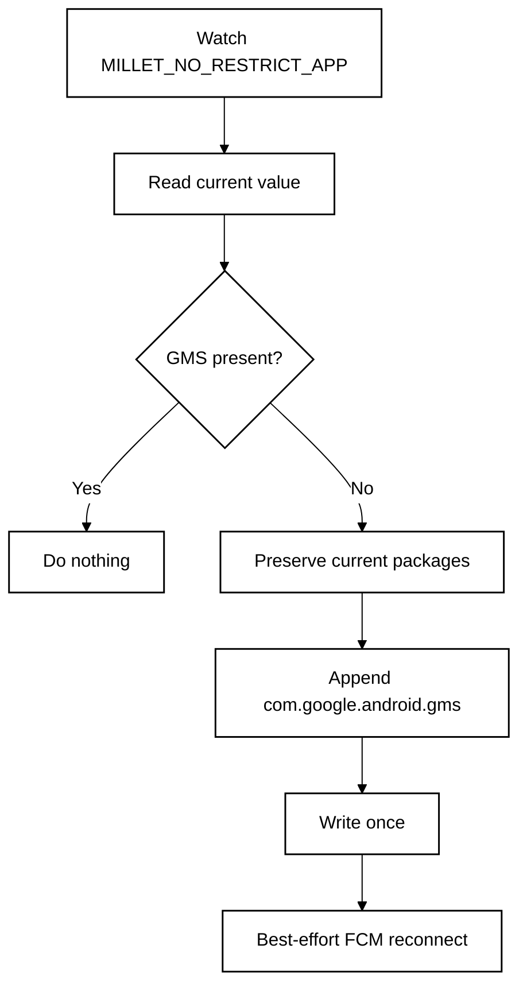

<p align="center">

Version 1.6.2 uses the application ID `com.rsps1008.fcmguard` (version code 32). Android treats it as a separate app from the previous package, so existing app settings, permissions and Shizuku authorization are not automatically transferred. Before removing the old app, disable its nighttime protection and complete any pending cleanup.
  <a href="README.md"><strong>English</strong></a> · <a href="README.zh-CN.md">简体中文</a>
</p>

<p align="center">
  
</p>

# FCM Guard for HyperOS

**A lightweight, no-root watchdog for HyperOS 3 China ROM that keeps Google Play services in Xiaomi's no-restrict background list so FCM push stays reliable.**

**Designed for:** China-market Xiaomi / Redmi / POCO phones with Google Play services already installed and working.

<p align="center">
  <a href="https://github.com/ReedGAOOO/FCMGuard-HyperOS/releases/latest/download/FCMGuard-HyperOS.apk"><strong>Download latest APK</strong></a>
  ·
  <a href="https://github.com/ReedGAOOO/FCMGuard-HyperOS/releases/latest">Latest release</a>
</p>

## Highlights

- **Low-privilege by default** — MILLET and Game Allowlist protection use user-grantable Modify system settings. The optional Aurogon Global sync uses a one-time `WRITE_SECURE_SETTINGS` grant through the existing, explicitly authorized Shizuku service; it does not require an ADB grant.
- **Finance-app friendly** — keeps the implementation deliberately low-privilege for better compatibility with security-sensitive apps.
- **Low background power** — exact event-driven monitoring is the main path; the 30-minute fallback is in-process and does not deliberately wake a sleeping phone.
- **Reconnects only when needed** — FCM/MCS reconnect broadcasts are sent only after a real whitelist repair or a manual request.
- **Optional persistent notification** — foreground mode uses a visible-but-silent notification channel for stronger process survival; quiet background mode remains available.
- **FCM app assistant** — scans likely Firebase/GCM clients and, when HyperOS exposes the vendor AppOps state, shows read-only Autostart status with automatic re-check after returning from system settings.
- **Native dark mode** — System / Light / Dark, with **System** as the default.
- **10-language UI** — English, Simplified Chinese, Traditional Chinese, French, Japanese, Korean, Spanish, Portuguese, German, and Russian through Android's native per-app language mechanism.
- **Compact-phone ready** — responsive layout checks cover 320–480dp widths, including a Xiaomi 17-class 393dp profile.

## Quick setup

1. Install the latest APK from **GitHub Releases**.
2. Open FCM Guard and grant **Modify system settings**.
3. Tap **Repair now** once.
4. Enable **Automatic protection**.
5. In HyperOS, enable **Autostart** for FCM Guard and set battery policy to **No restrictions**.
6. Keep **Persistent notification** enabled for maximum survival reliability. If Android/HyperOS blocks notifications for FCM Guard, the app opens the system notification settings so the foreground notification can be enabled.
7. Optional: scan **FCM apps**. If HyperOS exposes readable Autostart state, the list marks apps as Enabled / Partial / Disabled / Unknown and refreshes after you return from **Configure all in HyperOS**. If the ROM blocks the query, FCM Guard shows a clear Unknown/unavailable fallback instead of guessing.
8. Optional: tap **Open FCM diagnostics** to open Google Play services diagnostics and inspect the `mtalk.google.com:5228` connection.
9. If one app still receives notifications late while other FCM apps are normal, configure that app separately. For apps such as **WhatsApp**, set **Battery saver / Battery optimization → No restrictions** in HyperOS; enabling **Autostart** is also recommended when available.

> FCM Guard is mainly for China-ROM HyperOS 3 devices where Google services work normally but PowerKeeper / Greezer can still interrupt the background FCM connection.

---

# Technical overview

## Core mechanism

Affected HyperOS builds can rebuild the private setting:

```text
Settings.System.MILLET_NO_RESTRICT_APP
```

If `com.google.android.gms` is removed, Google Play services can be treated like a normal background process and its long-lived FCM/MCS connection may be interrupted.

FCM Guard reads the current comma-separated value, preserves all existing packages, and appends `com.google.android.gms` only when it is missing.



## Why `targetSdk 22`?

FCM Guard intentionally uses `compileSdk 35` with `targetSdk 22`. The modern compile SDK keeps current tooling, while the legacy target preserves the compatibility path needed to write Xiaomi's vendor-private `Settings.System` key with the user-grantable **Modify system settings** permission. The optional official Shizuku integration requires `minSdk 23`, so the build emits an intentional target/min warning; that warning is preferable to breaking the proven HyperOS private-setting write path.

## Low-power design

- Exact `ContentObserver` only for `MILLET_NO_RESTRICT_APP`.
- ~400 ms debounce after an observed change.
- 30-minute in-process fallback instead of rapid polling.
- No `AlarmManager`, repeating exact alarm, or WakeLock for the fallback.
- No write when GMS is already present.
- No reconnect broadcast unless a repair actually happened or the user requests one.

## Persistent notification

Persistent mode runs `GuardService` as a foreground service. The current implementation uses a dedicated `IMPORTANCE_LOW`, silent notification channel so the notification remains visible without sound or vibration. Because FCM Guard deliberately remains below Android 13's target level, Android 13+ controls the notification-permission prompt timing; if notifications are already blocked, FCM Guard links directly to the app's system notification settings.

## FCM diagnostics

**Open FCM diagnostics** now launches the current Google Play services activity first:

```text
com.google.android.gms/com.google.android.gms.gcm.GcmDiagnostics
```

Older `GTalkServiceDiagnostics` is retained as a compatibility fallback, with a final best-effort lookup for a diagnostics activity inside Google Play services.

## FCM app assistant

The scanner looks for standard manifest signals such as:

```text
com.google.firebase.MESSAGING_EVENT
com.google.android.c2dm.intent.RECEIVE
```

A match means the app is a likely FCM/GCM client, not proof that every notification from that app uses FCM.

For detected apps, FCM Guard performs a **read-only, best-effort** check of Xiaomi's vendor Autostart AppOps (`10008` and `10053`). When both are readable, the UI reports:

- **Enabled** — both Autostart AppOps are allowed.
- **Partial** — one is allowed and the other is explicitly ignored.
- **Disabled** — both are explicitly ignored.
- **Unknown** — HyperOS blocked the query, returned a vendor/default state that cannot be interpreted safely, or otherwise did not expose a reliable result.

FCM Guard never treats **Unknown** as **Disabled**. If every detected app is Unknown, the per-app list is hidden and the assistant falls back to the detected count plus the single **Configure all in HyperOS** action. After returning from HyperOS settings, an expanded result is checked again automatically.

The normal FCM app scan never modifies Autostart state or introduces Shizuku/root/ADB privilege.

### Optional Shizuku Autostart controls

When Shizuku is unavailable, tapping its button first opens the installed Shizuku
manager. Only if the manager is missing or cannot be opened does FCM Guard show
the existing unavailable message. Opening the manager does not start its daemon
or enable USB/Wireless debugging. Without usable Shizuku authorization, tapping
an app's Autostart status opens that app's system details page instead of requesting
a state change. With authorization, the existing enable/disable action is retained.

For advanced users, FCM Guard can request explicit Shizuku access after Shizuku
has already been installed and started by the user. Once authorized, tap an
app's existing Autostart status: **Enabled** requests disable; **Partial**,
**Disabled**, or **Unknown** requests enable for the two Xiaomi Autostart AppOps
(`10008` and `10053`). The command is executed
inside a short-lived Shizuku user service, not by the normal app process, and
FCM Guard then re-reads the status when HyperOS permits it.

This is optional and does **not** turn on USB debugging. On non-root phones,
the user must start Shizuku after a reboot using their own ADB or Wireless
debugging session. A successful command is not treated as verified unless the
subsequent read reports the expected state; unsupported or unreadable ROMs show
a clear unverified result and retain the HyperOS settings fallback.

## Per-app delivery caveat

FCM Guard protects the Google Play services / FCM transport layer, but it does **not** override HyperOS battery rules for every receiving app. Some apps — including messaging apps such as **WhatsApp** — may use FCM as a wake-up/tickle path and still need their own process to run, open a background network connection, synchronize data, and generate the local notification.

Therefore, if FCM diagnostics are healthy and other apps receive pushes normally but one app is still delayed, configure that app separately. For WhatsApp, the recommended HyperOS setting is:

**WhatsApp → Battery saver / Battery optimization → No restrictions**

Also enable **Autostart** for the affected app when the ROM exposes that option. This should be applied only to apps that actually show delayed delivery rather than globally disabling battery optimization for every app.

## Appearance, languages, and responsive layout

- System / Light / Dark appearance modes.
- 10 native app languages: English, Simplified Chinese, Traditional Chinese, French, Japanese, Korean, Spanish, Portuguese, German, and Russian.
- Compact and large-width resource profiles.
- CI geometry checks for 320, 360, 393, 411, 430, and 480dp widths.

## Permissions and privacy

FCM Guard declares `WRITE_SETTINGS`, `WRITE_SECURE_SETTINGS`, `RECEIVE_BOOT_COMPLETED`, foreground-service/notification support, and narrow package visibility for FCM/GCM handlers, Google Play services, and Xiaomi Security Center. Android does not grant `WRITE_SECURE_SETTINGS` to an ordinary install. The user can explicitly request its grant through Shizuku; FCM Guard checks the app permission after the request and reports failure if it remains unavailable.

It does not require root, persistent ADB, Accessibility, VPN, overlay, device-admin, account access, or traffic inspection. Aurogon sync needs Shizuku only for the initial `WRITE_SECURE_SETTINGS` grant; later Autostart reads and settings updates run under the app UID.

## Limitations

This project depends on Xiaomi's current HyperOS implementation. Xiaomi can change PowerKeeper / Greezer behavior, the private setting, app-management pages, or vendor AppOps behavior in future releases. FCM reconnect, FCM-client detection, and Autostart-status reading are all best-effort because Android does not expose public APIs that guarantee these vendor-specific operations.

FCM Guard protects the shared GMS/FCM connection; it cannot guarantee that HyperOS will allow every individual app enough background execution or network time to process a delivered FCM wake-up. Per-app battery settings may still be required for apps such as WhatsApp.

## References & Acknowledgements

The PowerKeeper / Greezer investigation and the `MILLET_NO_RESTRICT_APP` repair strategy were originally documented by **HyperOS FCM Fix**:

- HyperOS FCM Fix by `dingwen07`: https://github.com/dingwen07/hyperos-fcm-fix
- Technical investigation: https://github.com/dingwen07/hyperos-fcm-fix/blob/main/docs/xiaomi-hyperos-gms-fcm-greezer-investigation.md

FCM Guard is an independent implementation focused on minimal privileges by default, event-driven monitoring, and low idle background activity. Shizuku is an optional, explicitly authorized advanced control only. No source code from HyperOS FCM Fix is copied into this repository.

## Build

GitHub Actions checks responsive layout profiles and builds a signed debug APK. Pushes to `main` publish/update the versioned GitHub Release; feature branches can be validated before release.

For normal phone installation, use:

**https://github.com/ReedGAOOO/FCMGuard-HyperOS/releases/latest/download/FCMGuard-HyperOS.apk**

Android 6.0 (API 23) or newer is required because the optional official
Shizuku provider does not support Android 5.x.

## License

MIT License — see [LICENSE](LICENSE).

## Experimental HyperOS 4 nighttime FCM protection

The independent, default-off **Nighttime FCM protection** card uses ordinary app
`WRITE_SETTINGS` access to `Settings.System["com.miui.game.allowlist"]`. This part
does not require root, Shizuku, persistent ADB or Accessibility. The Aurogon
card has its own opt-in switch, off by default. When enabled, FCM Guard itself
reads user-installed apps' Xiaomi Autostart AppOps (10008 and 10053) and syncs
them to `Settings.Global["aurogon_enable"]` at startup and through the existing
30-minute in-process fallback. Manual clear and sync buttons remain disabled until
`WRITE_SECURE_SETTINGS` is granted; after that, they report the platform
write/read-back result. The periodic service is gated by the same permission.
In the Aurogon card's permission and operation guidance, Shizuku is mentioned
only when explaining automatic protection setup. The card can list user apps not currently covered by an active
Aurogon FCM rule without showing the underlying rule text. The legacy `targetSdk 22` and
original MILLET protection remain unchanged.

The separate, default-off **Aurogon alarm allowlist** card manages
`Settings.System["cloud_aurogon_alarm_allow_list"]`. It uses the same FCM receiver
scan and requires both Xiaomi Autostart AppOps to be enabled before adding a user
app. It always keeps the ROM's `com.tencent.mm`, `com.tencent.mobileqq`, and
`com.xtc.watch` entries and always adds `com.google.android.gms`, preserves entries it does not own, and removes only stale
entries it previously added. This card uses ordinary `WRITE_SETTINGS` and syncs on demand or through the shared 30-minute in-process
fallback while its switch is enabled. Manual sync remains available while the switch is off.
The card places **Restore default settings** and **Sync autostart apps** side by side, followed by a full-width **View apps protected by Aurogon alarms** button. Restore resets the setting to only the three built-in packages. If automatic sync remains enabled, a later sync will add GMS and eligible FCM apps again.
The allowlist only affects Aurogon's alarm-caching decision for frozen
apps; it does not prevent freezing, override WakePath, or guarantee FCM delivery.

This targets the China-ROM HyperOS 4 nightDoze policy observed at 23:00–07:59,
with screen off and deep Doze. It is an undocumented, experimental workaround,
not a push-delivery guarantee. Older or unrecognized ROMs are not automatically
classified as supported: the UI states that support/version cannot be verified.
Clearly non-Xiaomi devices are reported unsupported on repair. The exemption is
effective all day and can increase GMS background battery consumption.

The controller preserves the raw underscore-delimited list and order, uses exact
untrimmed tokens like the inspected Xiaomi parser, reads again before PUT and
requires an exact read-back. Packages containing underscores cannot be represented
intact by that vendor format. Initialization toggles one trailing underscore only
when GMS is already present; healthy checks never rewrite or reconnect. This
requests observer delivery, but cannot verify Xiaomi's loaded cache. Settings has
no compare-and-swap: an external writer can still race the final read/PUT. Failures
are not immediately retried by observer callbacks (60-second minimum gate); the
existing 30-minute in-process fallback or an explicit repair can retry. There is
no extra timer, alarm, job or wake lock. Broadcast requests are rate-limited to
one pair per 10 seconds; failed recovery may retry on a later fallback without
rewriting healthy membership.

The MILLET, Nighttime, Aurogon, and Aurogon alarm-list switches independently control the shared GuardService. Night
protection registers only its exact key observer, debounces for 400 ms, and is
checked again on startup. Foreground notification mode is shared and optional;
quiet mode is less reliable. Monitoring cannot run after the process is stopped.
Boot/package-replacement restart honors either enabled switch.

The dashboard shows the `WRITE_SECURE_SETTINGS` grant state and Aurogon sync
result. Sync includes only enabled user apps with an active FCM receive
component and both Xiaomi Autostart AppOps enabled. Apps whose Autostart state
is unreadable keep an existing managed rule, but are not newly added; known
disabled apps and stale rules are removed. An incomplete FCM component scan
leaves the current setting unchanged. Shizuku is only needed for the initial
permission grant. Aurogon's periodic sync runs only while its switch is
enabled; a manual sync remains available while it is off. The main app no longer exposes
the Night Protection debug/test buttons. Broadcast dispatch does not establish
receiver acceptance, thaw or connection. Original GTALK/MCS heartbeat actions
remain available through the existing repair flow.
Ordinary app permissions cannot verify frozen state, FCM sockets, clone-profile
recovery or controlled nighttime protection; the UI never reports these as
verified success. Deep Doze is left enabled.

The dashboard reports the night-protection summary, secure-settings permission,
simple Aurogon synchronization status and usage guidance; raw setting values are shown only on request.
Settings I/O and persistence run outside the UI thread.

Ownership is durably recorded before the first write. Disabling preserves
preexisting GMS, removes only app-added exact GMS tokens, preserves other entries,
and writes a non-null empty string when appropriate so the framework can observe
removal. Cleanup is reread and verified. Observable external changes mark ownership
uncertain; automatic deletion then stops and the Debug cleanup button requires
explicit consent to remove GMS. A same-value write by another app is inherently
undetectable. Failed/uncertain cleanup remains visible and retryable. **Disable
and complete cleanup before uninstalling or clearing data**: uninstallation cannot
run cleanup. Do not blindly restore an old full-list snapshot.

Implementation and verification details: [Night protection development notes](docs/nighttime-fcm-protection.md).
Research: [HyperOS 4 investigation](https://github.com/dingwen07/hyperos-fcm-fix/blob/main/docs/xiaomi-hyperos4-nighttime-fcm-investigation.md),
[reference controller](https://github.com/dingwen07/hyperos-fcm-fix/blob/main/app/src/main/java/net/extrawdw/apps/miuisucks/powerkeeper/GameAllowlistProtection.kt).

Release builds retain Lint checks. The deliberate legacy target is reported as an `ExpiredTargetSdkVersion` warning instead of a release-blocking error. In Android Studio, configure the Gradle JDK as JDK 21; the bundled JBR 25.0.3 crashes this project's current Lint version parser. The IDE Gradle JDK and command-line `JAVA_HOME` are separate settings.
